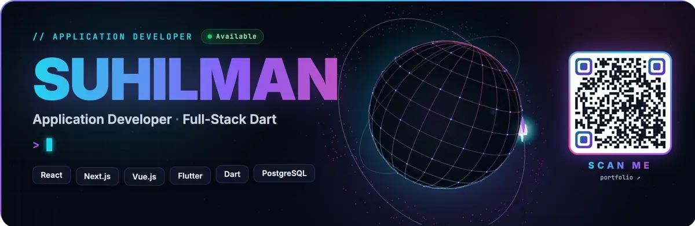

<!-- ===================== HERO 3D (Remotion + Three.js) ===================== -->

  

  
  
  
  

  

---

<!-- ===================== TECH STACK ===================== -->

  

<!-- ===================== PROFILE ===================== -->
### Tentang Saya

**Application Developer** dengan pengalaman **5+ tahun** membangun produk digital di bidang **telekomunikasi satelit, POS, CRM**, dan platform internal.

- Memimpin UI/UX & pengembangan **Network Monitoring System** yang dipakai harian oleh tim **BAKTI KOMINFO** untuk SATRIA-1 satellite HUB
- Spesialis **React, Next.js, Vue.js & Flutter**
- Fokus saat ini: **full-stack Dart** (Flutter + Frog + PostgreSQL)
- Membangun asisten AI enterprise & aplikasi real-time (WebSocket)
- Computer Science, **Universitas Pakuan**

<!-- ===================== EXPERIENCE ===================== -->
### Pengalaman

| Periode | Perusahaan | Peran |
|:--|:--|:--|
| `08/2023 — sekarang` | **PT. BIS Data Indonesia** · Jakarta | Front End Developer — NMS satelit BAKTI KOMINFO, HR platform, AI assistant |
| `08/2021 — 08/2023` | **PT. Life Tech Tanpa Batas** · Bandung | Front End Developer — BeetPOS, BeetClinic, CRM MRT |
| `12/2020 — 03/2021` | **Cave Laundry** · Bogor | Full Stack Developer — aplikasi kasir + real-time chat |

<!-- ===================== FEATURED WORK ===================== -->
### Featured Work

<table>
<tr>
<td width="33%" valign="top">

 
**NADIA** — Network Monitoring System 
SATRIA-1 HUB · BAKTI · 2024

Dashboard monitoring satellite HUB Jayapura; integrasi FortiGate, Huawei Core Switch & HPE ProLiant.

`Next.js` `MUI` `REST` `JWT`

</td>
<td width="33%" valign="top">

 
**VIONA** — Multi-HUB NMS 
Jayapura · Manokwari · Timika

Monitoring 3 satellite HUB: topologi berbasis peta, alert routing, status perangkat terpadu.

`Next.js` `Google Maps` `AWS`

</td>
<td width="33%" valign="top">

 
**Benggala** — Procurement Monitoring 
LKPP · BIS Data · 2026

Dashboard real-time metode tender & alokasi anggaran lembaga pengadaan nasional.

`Next.js` `Dashboard` `REST`

</td>
</tr>
<tr>
<td valign="top">

 
**ELARA** — Enterprise AI Assistant 
BIS Data · 2025

Asisten AI untuk reasoning, drafting, planning & Q&A atas dokumen, sheet, dan slide.

`Next.js` `AI Chat` `Markdown`

</td>
<td valign="top">

 
**ARTZ HR** — Full-Stack Dart 
BIS Data · 2024

Platform HR end-to-end: absensi, payroll, cuti, RBAC & audit log; mobile-first.

`Flutter` `Frog` `Dart` `PostgreSQL`

</td>
<td valign="top">

 
**BDI Chat** — Messaging + AI 
BIS Data · 2024

Chat real-time via WebSocket, full-text search, push notification & offline cache.

`Flutter` `Frog` `WebSocket` `PostgreSQL`

</td>
</tr>
<tr>
<td valign="top">

 
**BeetPOS** — POS & Back-Office 
Life Tech · 2021–2023

POS multi-tenant untuk retail & klinik; sinkron Tokopedia & Shopee, pembayaran QRIS.

`React` `Vue.js` `Vuetify` `Figma`

</td>
<td valign="top">

 
**CRM MRT** — Customer Relationship Mgmt 
Life Tech · 2021–2023

CRM dari nol: integrasi pembayaran, dashboard berbasis role, timeline aktivitas pelanggan.

`Vue.js` `Vuetify` `REST API`

</td>
<td valign="top">

 
**LOOKUP IP** — Internal Tools 
BIS Data · 2024

Pelacak IP, geolokasi & data jaringan perangkat; maintenance infrastruktur AWS.

`React` `Node.js` `AWS` `Maps API`

</td>
</tr>
</table>

<b>10+ proyek lainnya</b> di balik layar — lihat <a href="https://suhilman.github.io/SUHILMANartz">portfolio</a>

<!-- ===================== SKILLS ===================== -->
### Core Skills

  

<!-- ===================== GITHUB STATS ===================== -->
### GitHub Stats

  
  

  

<!-- ===================== SNAKE ===================== -->

  <picture>
    <source media="(prefers-color-scheme: dark)" srcset="https://raw.githubusercontent.com/Suhilman/suhilman/output/github-contribution-grid-snake-dark.svg"/>
    <source media="(prefers-color-scheme: light)" srcset="https://raw.githubusercontent.com/Suhilman/suhilman/output/github-contribution-grid-snake.svg"/>
    
  </picture>

<!-- ===================== CONTACT / QR ===================== -->
### Let's build something

<table>
<tr>
<td width="55%" valign="middle">

Terbuka untuk **freelance**, **product roles** & **kolaborasi**.

Scan QR di samping atau klik tombol di bawah untuk melihat **portfolio lengkap**, featured work, dan kontak.

</td>
<td width="45%" align="center">
  
</td>
</tr>
</table>

  

