<!-- ===================== HERO 3D (Remotion + Three.js) ===================== -->

  

  
  
  
  

  

---

<!-- ===================== TECH STACK ===================== -->

  

<!-- ===================== ABOUT ===================== -->

  

<!-- ===================== EXPERIENCE ===================== -->

  

<!-- ===================== FEATURED WORK ===================== -->

  

<b>10+ more projects</b> behind the scenes — see the <a href="https://suhilman.github.io/SUHILMANartz/">portfolio</a>

<!-- ===================== SKILLS ===================== -->
### Core Skills

  

<!-- ===================== GITHUB STATS ===================== -->
### GitHub Stats

  
  

  

<!-- ===================== SNAKE ===================== -->

  <picture>
    <source media="(prefers-color-scheme: dark)" srcset="https://raw.githubusercontent.com/Suhilman/suhilman/output/github-contribution-grid-snake-dark.svg"/>
    <source media="(prefers-color-scheme: light)" srcset="https://raw.githubusercontent.com/Suhilman/suhilman/output/github-contribution-grid-snake.svg"/>
    
  </picture>

<!-- ===================== CONTACT / QR ===================== -->
### Let's build something

<table>
<tr>
<td width="55%" valign="middle">

Open to **freelance**, **product roles** & **collaboration**.

Scan the QR code or use the buttons below to see the **full portfolio**, featured work and contact details.

</td>
<td width="45%" align="center">
  
</td>
</tr>
</table>

  

